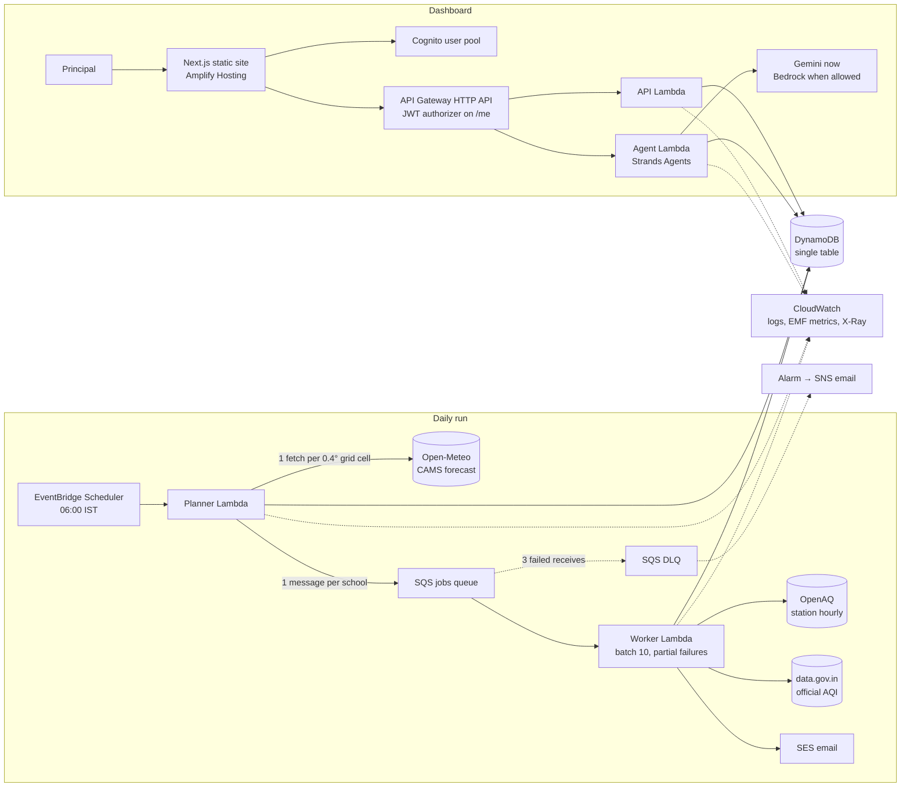

# AirDay architecture

AirDay turns an hourly air-pollution forecast into a period-by-period plan for a school's timetable, emailed to the
principal at 06:00 IST. This document covers how it is built, why, what it costs, and how it fails.

## System

| Component | Role |
|---|---|
| `airday.engine` | Pure function: hourly concentrations + timetable → actions with rule IDs. No I/O. |
| `airday.validator` | Runs before every email. A brief with an unknown rule ID, a missing activity or "AQI" on an hourly number is never sent. |
| `airday.service` | The only module that mixes I/O with the engine. Tenant-scoped, reads upstream through a shared cache. |
| `airday.fanout` | Planner (warm cache, enqueue) and worker (build, store, email) logic, independent of Lambda. |
| `airday.api` | One router for both the Lambda and the local dev server. Resolves a principal before any handler runs. |
| `airday.agent` | Strands agent with two read-only tools that wrap the engine. Output is checked for rule IDs it actually received. |
| `rules/rules.yaml` | Every threshold and every action. Engine, validator, dashboard and tests read it; nothing else hard-codes a rule. |

## Request paths

**06:00 run.** Scheduler invokes the planner. The planner reads the school registry, snaps each school to its CAMS
0.4° grid cell, fetches each cell's forecast once into the shared cache, and sends one SQS message per school. Workers
build each brief from the cache, validate it, store it, and send the email through the claim protocol below.
Delhi with 1,000 schools is two or three forecast calls, not 1,000.

**Dashboard.** Static Next.js on Amplify. Signed-in principals call `/me/*` with a Cognito ID token; API Gateway's JWT
authorizer verifies it before any Lambda runs, and the API maps the token's `sub` to that user's school server-side.
The school ID is never accepted from the client. The public demo school is served on `/*`, read-only.

## Data model

One DynamoDB table, `PK`/`SK`, on-demand, point-in-time recovery, TTL on `expiresAt`.

| PK | SK | Holds |
|---|---|---|
| `SCHOOL#<id>` | `PROFILE` | Name, location, hours, school days, holidays, principal email, owner |
| `SCHOOL#<id>` | `ACTIVITY#<id>` | One outdoor slot |
| `SCHOOL#<id>` | `BRIEF#<date>` / `REPLAY#<date>` | Stored plan (live and replay never collide) |
| `SCHOOL#<id>` | `EMAIL#<date>` | Send state: SENDING / SENT / FAILED, attempts |
| `USER#` | `SCHOOL` | Which school a Cognito user owns |
| `REGISTRY` | `SCHOOL#<id>` | School index for the planner, with grid cell |
| `CACHE` | `openmeteo#<cell>#<date>` etc. | Upstream responses shared across tenants (TTL 2 days) |
| `COUNTER#<date>` | `AGENT#<school>` | Per-tenant daily chat cap (TTL 7 days) |

Every access pattern is a `GetItem` or a `Query` on one partition. There are no scans.

## Reliability

| Failure | Behaviour |
|---|---|
| SQS redelivers a job | The brief write is an overwrite. The email claim (`attribute_not_exists OR status=FAILED AND attempts<3`) lets only one send through. |
| SES rejects a send | Claim marked FAILED, Lambda raises, SQS retries; up to 3 attempts, then the DLQ alarm fires. |
| Crash after SES accepted, before SENT recorded | The claim stays SENDING and no second email goes out. The guarantee is at most one automatic email per school per day. |
| One school's job keeps failing | Only that message returns to the queue (`ReportBatchItemFailures`); others in the batch complete. DLQ after 3 receives. |
| Open-Meteo down | Stale cache with "cached from HH:MM", otherwise every activity becomes `R-UNK-*` ("check the official AQI"). Nothing is guessed. |
| OpenAQ or data.gov.in down | That field shows "unavailable"; the brief still goes out. |
| Brief fails validation | No plan is sent. The principal gets "today's plan could not be built", and the job fails visibly. |
| Run starts after 07:30 | Skipped and logged, so a stale plan never arrives mid-morning. |
| Upstream overload from fan-out | The SQS event source caps the worker at 5 concurrent runs; the shared cache means workers rarely call upstream at all. |

## Security

- **Tenant isolation.** The school ID comes from the verified token's `sub` via `USER#`, never from the request.
  Tested in `tests/test_tenancy_and_fanout.py`.
- **Auth.** Cognito user pool, email sign-in, SRP, 1-hour tokens. JWT verified at API Gateway.
- **Demo writes.** The public demo school accepts writes only with an admin key (SSM SecureString, constant-time
  compare) and only while `DemoAdmin=true`. Turn it off outside the hackathon.
- **Least privilege.** Each Lambda's policy names its own table, queue and `/airday/<stage>/*` parameters.
- **Data.** DynamoDB, SQS and SNS encrypted at rest. The public profile endpoint never returns the principal's email.
- **Cost abuse.** API Gateway throttling per route, a per-tenant daily agent cap, and an AWS Budgets alert.
- **Prompt injection.** Agent tools are read-only and return only that tenant's data. An injected answer that cites
  a rule ID no tool returned is rejected.

## Observability

Powertools for AWS Lambda (AWS open source) on every function:

- Structured JSON logs with Lambda context. One `daily_brief` line per school per day: bands, rule IDs, escalations,
  upstream status, email result.
- X-Ray tracing on all functions, annotated by route.
- EMF metrics in the `AirDay` namespace: `SchoolsQueued`, `BriefBuilt`, `BriefFailed`, `BriefSkipped`, `EmailSent`,
  `ChangesRecommended`, `StationEscalations`, `ForecastCellsWarmed`, `Http2xx/4xx/5xx`.
- A CloudWatch dashboard (`airday-<stage>`) and alarms for the DLQ, planner errors and "no briefs built this hour".

## Does the advice match reality?

[`backend/backtest/report.md`](../backend/backtest/report.md) scores the engine against 9 Delhi reference stations,
Oct–Dec 2025, school hours on school days (4,447 hours). It is rerun in CI and must match the committed report.

| Strategy | Very Poor+ hit rate | False alarms |
|---|---|---|
| 06:00 email, forecast only | 30% | 4% |
| 06:00 email, station band as a floor (production) | 93% | 12% |
| Live dashboard, forecast + station escalation | 94% | 9% |

CAMS reads about 100 µg/m³ cleaner than Delhi stations in winter, so the forecast alone misses most bad hours. That
result changed the design: the production brief now floors the day at the latest fresh station band (ADR 0004).

## Cost

Estimates for ap-south-1 from public on-demand prices, before free tier. Check with the AWS Pricing Calculator.

| Per school per month (26 school days) | Estimate |
|---|---|
| Worker Lambda, ~1 s at 512 MB per day | < $0.001 |
| DynamoDB, ~30 requests per day | ~$0.001 |
| SES, 1 email per day | ~$0.003 |
| Shared forecast fetch | ~0 (one per grid cell) |
| **Total, without chat** | **under $0.01** |

Chat currently runs on Gemini (free tier) because Bedrock is blocked on this account; on Nova Lite it would cost a fraction of a cent per question at about 3,000 input and 300 output tokens. Either way it is capped
per tenant per day. Fixed costs (Cognito under 10,000 users, API Gateway, CloudWatch at this volume) fall inside free
tier or cost cents.

## Scaling limits

| Limit | Where it bites | Next step |
|---|---|---|
| Planner reads every profile to find its grid cell | Tens of thousands of schools | Store the grid cell in the registry row (already written) and read only that |
| SES sending quota | Sandbox: 200/day; production access raises it | Request production access; batch by domain |
| Worker concurrency 5 (account limit 10) | ~9,000 schools in a 30-minute window at 1 s each | Request a Lambda concurrency increase and raise `MaximumConcurrency` |
| One region | Regional outage | The table and schedule can be replicated; not worth it at this stage |

## Decisions

Short records in [`docs/adr/`](adr/):

1. [Serverless on Lambda, not containers](adr/0001-serverless.md)
2. [Single-table DynamoDB](adr/0002-single-table-dynamodb.md)
3. [Decide on concentrations, not hourly AQI](adr/0003-concentrations-not-aqi.md)
4. [Station band floors the forecast](adr/0004-station-floor.md)
5. [Deterministic rules, LLM only for language](adr/0005-rules-not-llm.md)
6. [Fan-out through SQS with a shared forecast cache](adr/0006-fanout-and-shared-cache.md)
